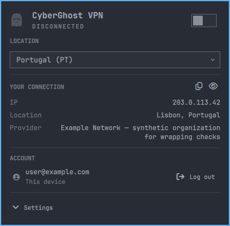
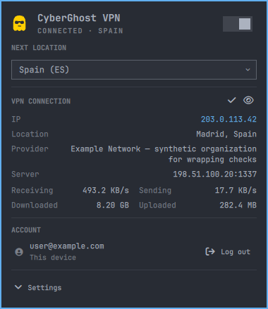

# CyberGhost VPN for Omarchy

<p align="center"></p>

A WireGuard VPN plugin for the Omarchy bar. Choose a country and connect with one click. The tunnel is an ordinary NetworkManager connection, so on Omarchy it needs no root helper, no extra system packages and no password prompt.

[Open the CyberGhost plugin in the Omarchy plugin directory](https://plugins.omarchy.org/plugin.html?id=miguel.cyberghost)

Version 1.7.2 prepares compatibility with Omarchy 4.5 / Qt 6.12. The larger service and UI update is tracked in the [implementation plan](docs/omarchy-4.5-plan.md).

## Preview

<p align="center">
  
  
</p>

Preview images use synthetic account and connection data, not a live VPN session.

## Install

```bash
omarchy plugin add https://github.com/27mfp/miguel.cyberghost.git --enable
```

Open the ghost icon and complete the setup steps:

1. If `python-requests` is missing, install it from the panel (it opens Omarchy's floating terminal).
2. Link your CyberGhost account. Native credentials are stored in `~/.cyberghost/native.ini`.

That's it: connecting uses NetworkManager, which Omarchy already runs, and its Polkit policy already lets your desktop session manage network connections. The vendor CLI is not required.

From a checkout, one script owns every mode:

```bash
bash install.sh              # guided setup (dependencies + account link)
bash install.sh --dry-run    # print the plan without changing anything
bash install.sh --uninstall  # remove the plugin, native credentials and recognized legacy files
bash install.sh --fresh      # destructive developer reset, then reinstall
```

`fresh-install.sh` still works but is deprecated: it now delegates to
`install.sh --fresh`. See the [installer reference](INSTALLER.md).

## Use

- The bar icon opens a dashboard with one observed-state display and one primary action. **Account** and **Settings** are direct header icons; **Details** opens from the main view. **Back** or Esc returns.
- Pick a destination with the country picker or the **Quick destinations** shortcuts. Favorites (up to 8) and recent verified NetworkManager destinations (up to 5) are stored locally in the shell settings; choosing one only sets the next destination and never starts a connection.
- The primary action is context-aware: **Connect** when disconnected, **Switch to …** when another country is selected on an active tunnel, or **Disconnect** otherwise. A pending switch keeps its own **Disconnect** action.
- While connected, the tunnel also appears as **CyberGhost VPN** in `nmcli` and Omarchy's network tools. It lives only in memory and is gone after a NetworkManager restart or reboot.
- If the VPN status can't be verified, or the tunnel looks stale, the panel shows a notice with **Recheck status**, which never connects. Operation errors can be dismissed.
- Traffic rates appear after two status checks; until then the details show "Sampling traffic…".
- IP, location, provider and account name are hidden by default for new installations. Toggle the privacy preference in **Settings**; saved preferences from earlier releases are respected.
- **Link account** needs the VPN disconnected; the panel explains inline when linking is blocked. Account can also be relinked without logging out or forgetting cached credentials.
- Keyboard: Tab/Shift+Tab move through controls, Ctrl+Tab / Ctrl+Shift+Tab switch adjacent Omarchy popouts, `t` toggles the VPN, `c` copies the public IP, `h` toggles privacy, `r` refreshes, and Esc goes back or closes.
- **Account → Log out** forgets this device's login (`~/.cyberghost/native.ini`) after a second confirming click, disconnecting first if needed. An account from the CyberGhost CLI's own `config.ini` is shown but left alone. Logging out does not remove the device from your CyberGhost account; do that on CyberGhost's website if you no longer use it.
- Left-click opens the panel; middle- and right-click toggle the VPN.

Server selection is automatic, in this order: the vendor CLI's inventory if installed; CyberGhost's own live server list (least loaded first) while your login session is valid (about a day after **Link account**); otherwise real server names from your local cache, probed for the fastest reachable host. While the session is valid, the plugin fills that cache for every country in the background, from your own account. The Account section shows "syncing servers" with its progress. Nothing needs to be set up or refreshed by hand. Linking your account again refreshes the list.

```bash
python3 ~/.config/omarchy/plugins/miguel.cyberghost/cyberghost_runner.py probe --all
```

## Scope and limits

- Supported mode: native WireGuard traffic connections only.
- OpenVPN, streaming, torrent, and manual-server controls are not supported.
- This is not a kill switch and does not claim leak protection or anonymity.
- VPN DNS is set exclusively on the tunnel (`~.` routing domain). If you chose a provider with `omarchy dns`, Omarchy's global DNS still applies and those queries travel through the tunnel.
- A separate vendor VPN session is not managed by this plugin.
- Public-IP lookup uses `ipwho.is`; privacy mode only masks the displayed values.

The plugin preserves the vendor's `~/.cyberghost/config.ini`. Disconnect before removing or upgrading from an experimental vendor-based version.

## Update and remove

```bash
omarchy plugin update miguel.cyberghost
```

The updater rescans plugins, but an already-loaded widget can retain cached QML. If the panel still shows old controls or setup instructions, run `omarchy restart shell`, then reopen the ghost icon. This briefly restarts the bar and shell UI; it does not restart NetworkManager.

**Upgrading from 1.6.x or earlier:** disconnect once (the old helper removes its own tunnel), then use **Settings → Advanced → Remove old root helper…**, or run `bash scripts/remove-legacy-helper.sh`. Disconnect before removal. See the [installer reference](INSTALLER.md) for details.

## Development

```bash
pytest -q
ruff check . && ruff format --check .
mypy
bash scripts/test-qml.sh
python3 scripts/check_manifest.py
python3 scripts/sync-preview.py --check
```

The backend is the `cyberghost/` package (constants, validation, transport,
server data, NetworkManager lifecycle, setup and CLI), with
`cyberghost_runner.py` kept as the stable entry point. See
[CONTRIBUTING.md](CONTRIBUTING.md) for the full check list and conventions, and
[SECURITY.md](SECURITY.md) for the threat model and private reporting process.

Read the [release checklist](docs/release-checklist.md), [architecture](docs/architecture.md), and [testing guide](docs/testing.md) for additional details. The repository contains experimental vendor compatibility code, but it is not part of the supported release.
